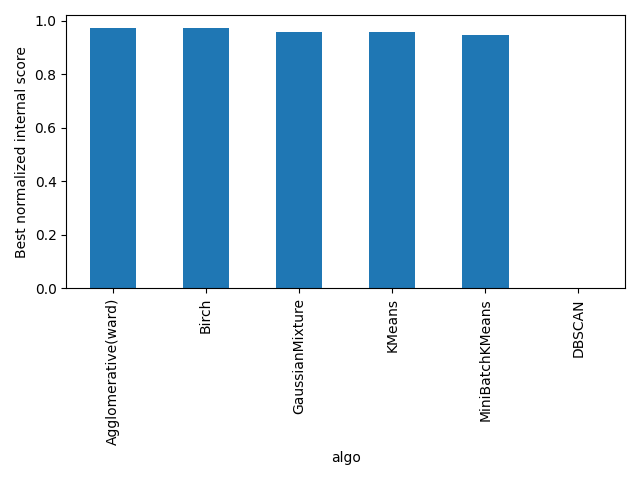
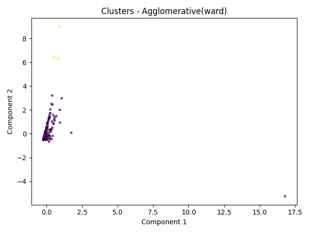

# Astral — Unsupervised Clustering

> Experimento de aprendizado não supervisionado aplicado à análise de **sequências de proteínas**, com extração de atributos, redução de dimensionalidade, comparação de algoritmos e visualização de resultados.


## Visão geral

A ideia do projeto é comparar diferentes estratégias de **clusterização** para descritores construídos a partir de sequências de aminoácidos em formato FASTA.

O pipeline disponível no código percorre as seguintes etapas:

1. **Leitura e limpeza:** leitura de sequências FASTA e retenção dos 20 aminoácidos canônicos.
2. **Engenharia de atributos:** ocorrência binária de pares de aminoácidos separados por um intervalo configurável (`x-skip`), gerando uma representação esparsa de até **160.000 atributos**.
3. **Redução de dimensionalidade:** uso de `TruncatedSVD` para trabalhar com a matriz esparsa e `StandardScaler` para padronização.
4. **Comparação de modelos:** K-Means, MiniBatch K-Means, Agglomerative (Ward), Gaussian Mixture, Birch e DBSCAN.
5. **Avaliação e visualização:** métricas internas, F1 com mapeamento ótimo de rótulos e gráficos comparativos.

## Como o projeto está organizado

```text
data/                   # artefatos de amostra e entrada FASTA
scripts/
  extract_features_fast.py   # FASTA -> matriz CSR (.npz) + rótulos (.json)
  pca_and_cluster_fast.py    # SVD, clusterização, métricas e gráficos
results/sample_fast/
  metrics.csv                # resultados de uma execução registrada
  best_config.json           # configuração selecionada nessa execução
  plots/                     # gráficos gerados
run_fast_windows.ps1         # execução do pipeline via PowerShell
```

## Requisitos

- Python 3.10+ recomendado.
- Bibliotecas usadas no código: `numpy`, `scipy`, `scikit-learn`, `pandas`, `matplotlib` e `tqdm`.

Instalação sugerida em um ambiente virtual:

```bash
python -m venv .venv
# Linux/macOS: source .venv/bin/activate
# Windows PowerShell: .venv\Scripts\Activate.ps1
python -m pip install numpy scipy scikit-learn pandas matplotlib tqdm
```

## Execução

**Importante:** o arquivo `data/astral_sample.txt` presente no repositório está vazio. Para reproduzir o experimento, use **um arquivo FASTA real** de sequências de proteínas, com ao menos algumas sequências válidas.

```bash
python scripts/extract_features_fast.py \
  --fasta data/sequencias.fasta \
  --out-features data/features.npz \
  --out-labels data/labels.json \
  --x-skip 0 \
  --max-seqs 300

python scripts/pca_and_cluster_fast.py \
  --features data/features.npz \
  --labels data/labels.json \
  --out-dir results/minha_execucao \
  --k-range 2:10 \
  --n-components 150
```

O script `run_fast_windows.ps1` automatiza os dois comandos, mas aponta para o arquivo de amostra vazio; ajuste `$FASTA` para sua entrada antes de executá-lo.

### Avaliação

Os resultados incluem:

| Métrica | Interpretação |
|:--|:--|
| **Silhouette** | Coesão e separação dos grupos |
| **Calinski–Harabasz** | Separação entre grupos comparada à dispersão interna |
| **Davies–Bouldin** | Semelhança relativa entre grupos (menor tende a ser melhor) |
| **F1 macro mapeado** | Comparação com rótulos de referência após correspondência ótima de clusters |

O `best_config.json` salvo no repositório registra **Agglomerative (Ward), k=2** como melhor pelo escore interno normalizado da execução de amostra. Isso **não prova superioridade geral do modelo**: trata-se de um conjunto e de um critério específicos. O F1 mapeado registrado nessa execução é muito baixo (~0,0017).

**Limitação importante:** por padrão, o extrator usa o identificador do cabeçalho FASTA como rótulo de referência. Quando cada sequência tem um identificador próprio, o F1 externo não representa uma classificação biológica significativa. Para avaliação supervisionada real, use rótulos de famílias/classes adequados e verifique a correspondência entre amostras.

## Resultados salvos

<table>
  <tr>
    <td width="50%"></td>
    <td width="50%"></td>
  </tr>
</table>

[Consultar todas as métricas](results/sample_fast/metrics.csv) · [Configuração escolhida na execução de exemplo](results/sample_fast/best_config.json)

## Próximos passos

- Disponibilizar um FASTA de demonstração válido e reproduzível, com informações de origem.
- Registrar versões de dependências e sementes de execução.
- Melhorar a metodologia de rótulos de referência e validação externa.
- Adicionar testes automatizados para o extrator e o pipeline.

---

**Projeto de estudo e experimentação**, voltado a ciência de dados, bioinformática e aprendizado de máquina. Criado por [Talysson Decol](https://github.com/TalyssonDLF).
